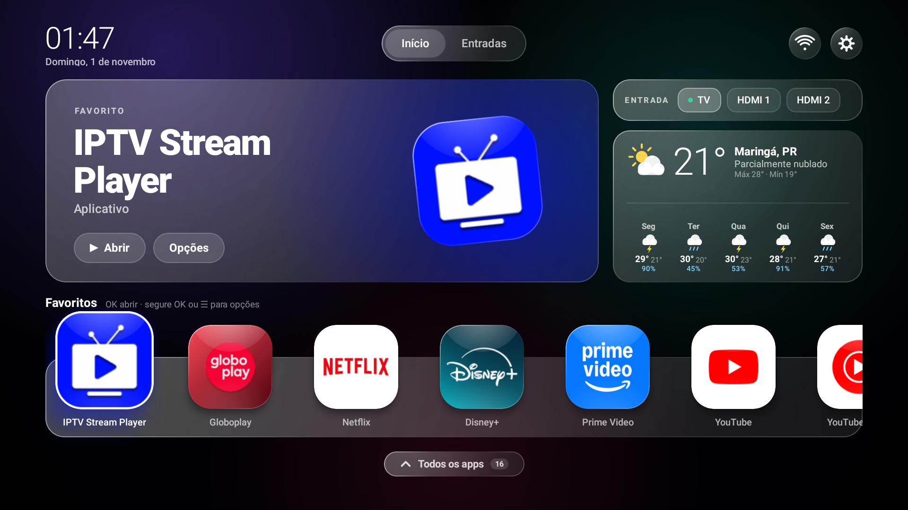
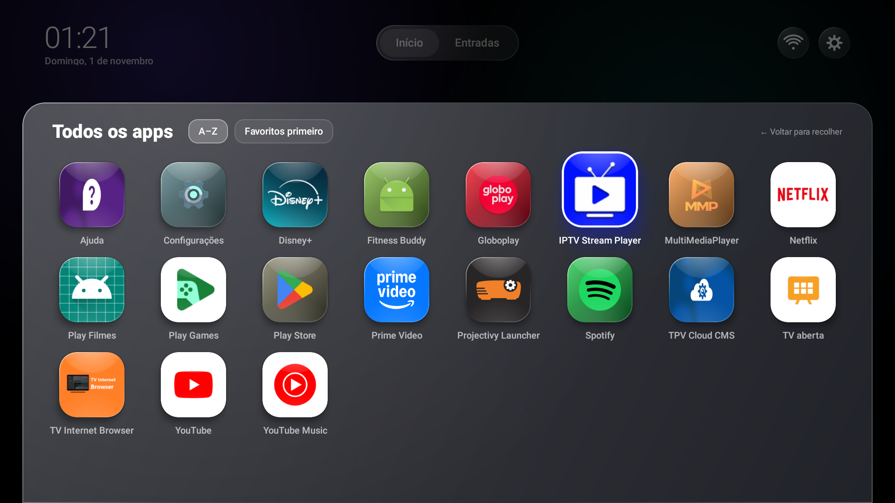
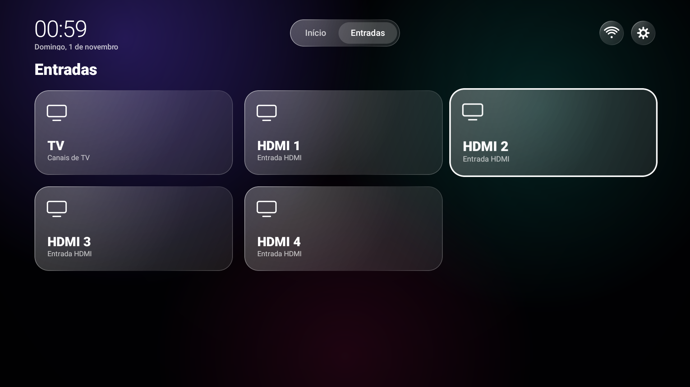
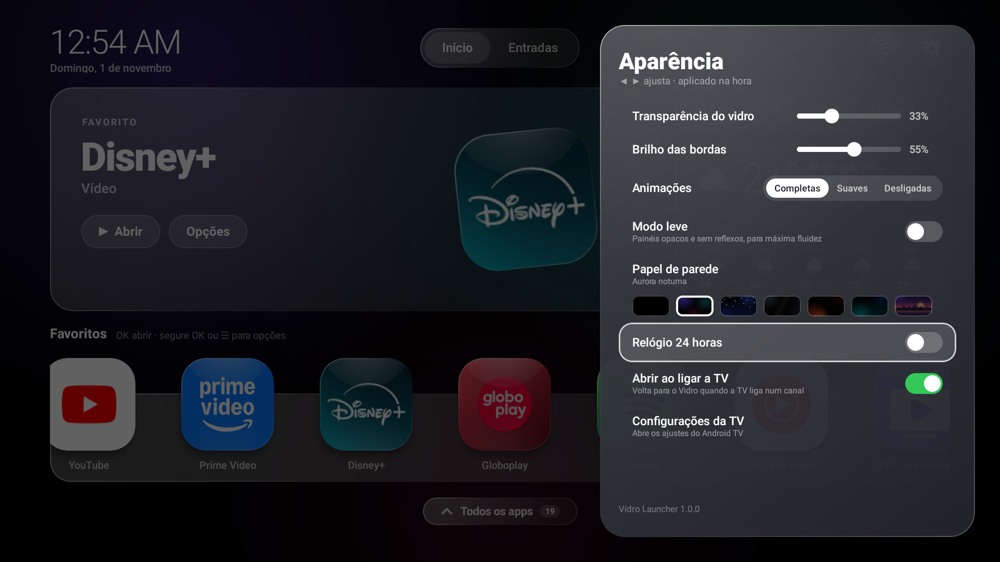

# GlassLauncherTV (Vidro)

Tela inicial com visual "vidro líquido" para Android TV, leve o bastante para TVs de entrada. Feita e testada numa **Philips 55PUG7906/78 (Android TV 11, MediaTek, 1,3 GB de RAM)**, sem root.



| Todos os apps | Entradas | Aparência |
|---|---|---|
|  |  |  |

## Recursos

- Favoritos com destaque grande do app selecionado, reordenáveis pelo controle (segure OK ou ☰ → "Mudar de lugar")
- Gaveta "Todos os apps", escondida até ser aberta
- Entradas da TV (antena e HDMI) e atalho para as redes Wi-Fi
- Previsão do tempo com hoje e os próximos 5 dias (Open-Meteo, sem chave e sem dados pessoais)
- 7 papéis de parede escuros, incluindo "Total Black"; transparência, brilho das bordas, animações e modo leve ajustáveis
- Opção de voltar para a tela inicial quando a TV liga
- Navegação 100% pelo controle remoto; parado, não desenha nada (zero uso de GPU/CPU)

## Instalar

Baixe o APK em [Releases](../../releases) e instale pela rede com ADB:

1. Na TV: Configurações → Preferências do dispositivo → Sobre → clique 7× em "Build". Depois, em Opções do desenvolvedor, ligue **Depuração USB**.
2. No computador ([Platform Tools](https://developer.android.com/tools/releases/platform-tools)):
```bash
adb connect IP-DA-TV:5555
adb install GlassLauncherTV-1.0.1.apk
adb shell appops set com.vidro.launcher SYSTEM_ALERT_WINDOW allow   # opcional: "Abrir ao ligar a TV"
```

Para usar como tela inicial (botão Home), veja [docs/TELA-INICIAL.md](docs/TELA-INICIAL.md). Lá estão os riscos e como desfazer.

## Compilar

Requer JDK 17 e Android SDK 34.
```bash
./gradlew assembleRelease
```
O APK sai em `app/build/outputs/apk/release/`. Sem uma chave própria em `assinatura/vidro.keystore`, ele é assinado com a chave de depuração do seu SDK.

Personalização: a cidade da previsão está fixa em `app/src/main/java/com/vidro/launcher/data/Weather.kt` (latitude e longitude) e no texto do cartão em `ui/Screens.kt`. Os favoritos iniciais ficam em `DEFAULT_FAVS`, em `ui/LauncherState.kt`.

## Limitações

- Prévias de conteúdo dos apps (Netflix, YouTube…) exigem uma permissão de sistema (`ACCESS_ALL_EPG_DATA`); o destaque mostra o ícone do app.
- Android 11 não oferece desfoque em tempo real: o "vidro" é feito de degradês translúcidos.
- Em algumas TVs, o firmware só respeita outra tela inicial se a do Google for desativada (ver docs).
- Testado apenas na Philips 55PUG7906. Outras TVs com Android TV 11+ devem funcionar, mas sem garantia.

## Aviso

Projeto pessoal, sem relação com Philips, TP Vision, MediaTek ou Google. Use por sua conta e risco. Nenhum passo exige root nem altera o firmware, e todos são reversíveis.

Licença: [MIT](LICENSE).
